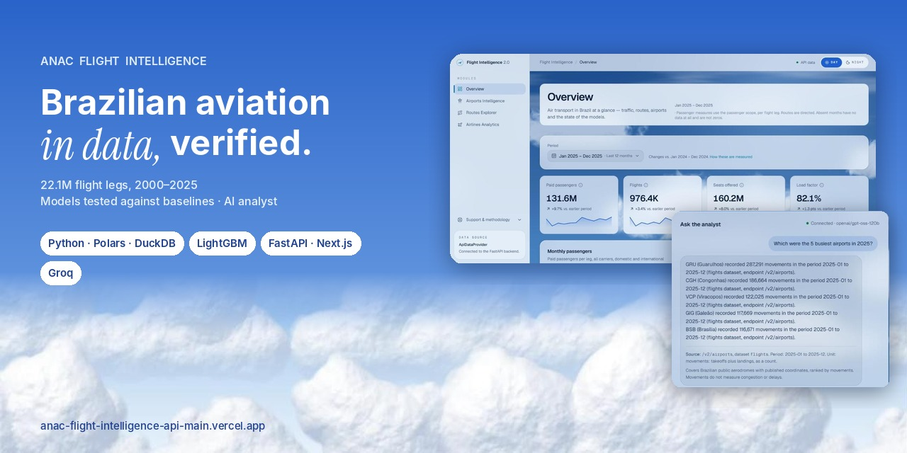
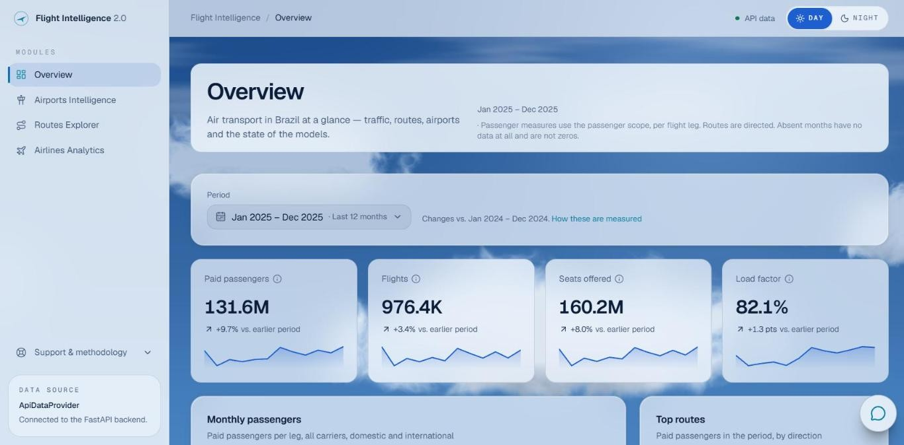
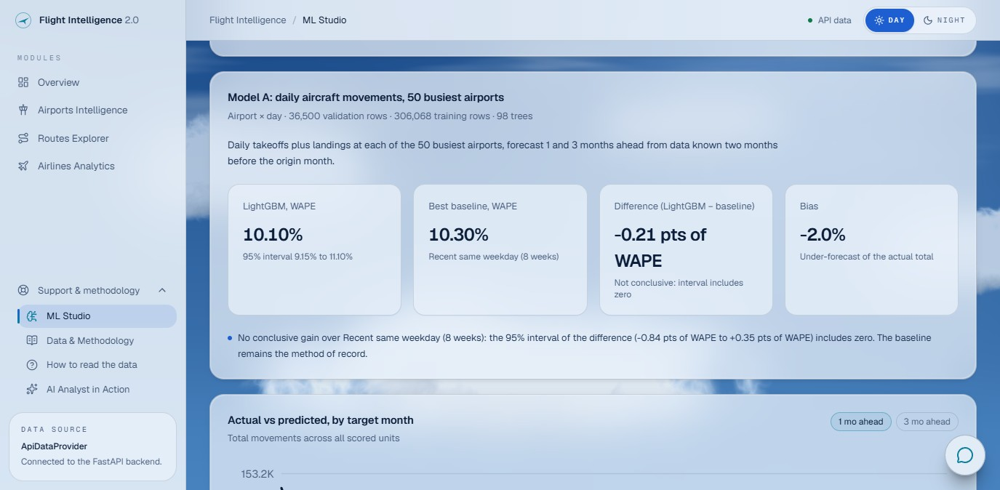
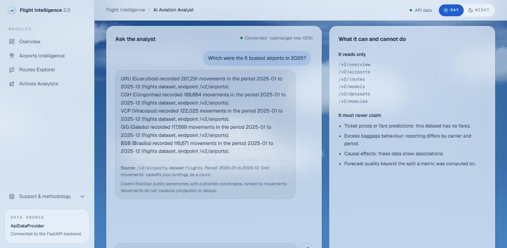
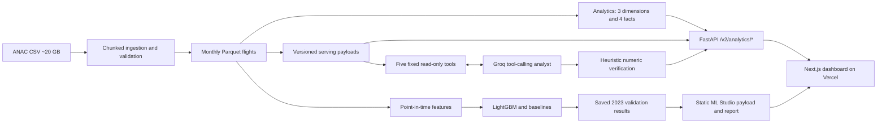

<p align="center"></p>

# ANAC Flight Intelligence

**From 22,120,241 aviation records to traceable market analysis.** An end-to-end data and ML platform built on ANAC's open aviation microdata for Brazil, January 2000–December 2025. It combines audited ingestion, an analytical star schema, temporal model evaluation and an LLM analyst grounded in fixed data tools.

[Live dashboard](https://anac-flight-intelligence-api-main.vercel.app/dashboard) · [ML Studio](https://anac-flight-intelligence-api-main.vercel.app/dashboard/ml-studio) · [AI Analyst](https://anac-flight-intelligence-api-main.vercel.app/dashboard/analyst) · [API documentation](https://anac-flight-intelligence-api-v2.onrender.com/docs)

[10-slide presentation — PDF](docs/portfolio/presentation/anac-flight-intelligence-presentation-en.pdf) · [Editable PowerPoint](docs/portfolio/presentation/anac-flight-intelligence-presentation-en.pptx) · [Case study](docs/portfolio/CASE_STUDY.md) · [Documentation](docs/README.md) · [Português](docs/portfolio/pt-BR/README.md)

## See it in action

| Market dashboard | ML Studio | AI Analyst |
|---|---|---|
|  |  |  |

These are screenshots of the public application, not mockups. The Analyst image records a historical live answer; new answers depend on provider availability and usage limits. [Gallery and provenance](docs/portfolio/assets/README.md).

## Why this project exists

Open data does not automatically produce correct answers. Flights, passenger flights and airport movements are different counts. Routes have direction. Seat occupancy must be recomputed from passenger and seat totals. Four source months are missing and must remain unknown rather than become zero.

The platform makes those definitions explicit and testable. It provides period and entity filters, airport and airline rankings, monthly series, model diagnostics and plain-language questions supported by a small set of read-only tools.

## Architecture



The analytical and ML branches share audited source data but have different grains and scopes. The Analyst uses exported tools, not unrestricted SQL or the entire historical dataset. [Architecture and contracts](docs/ml/en/ML_ARCHITECTURE.md).

| Layer | Technology and purpose |
|---|---|
| Ingestion and storage | Python 3.12, Polars, Parquet; bounded chunks, resumable atomic publication |
| Independent validation | DuckDB; line accounting, partition checks and analytical reconciliation |
| ML | Four LightGBM regressors, ten baseline references; chronological splits and month-cluster bootstrap |
| Backend | FastAPI, Pydantic, mirrored TypeScript contracts; Docker on Render |
| Frontend | Next.js 16, React 19, TypeScript, Tailwind 4; DAY/NIGHT themes on Vercel |
| Generative AI | Groq, OpenAI-compatible tool calling, fixed tools, numeric checks, server-side credentials |
| Quality | pytest, Ruff, strict mypy, Vitest, Testing Library, TypeScript and production build |

## Data and verified scale

- **22,120,241 records**, **308 observed months** across a 312-month calendar; full ingestion and independent read-back are recorded in [the ingestion report](reports/ingestion/INGESTION_REPORT.md).
- **Seven analytical tables:** three dimensions and four facts, reconciled across all observed months. [Validation evidence](reports/analytics/validation.json).
- Missing months: **2015-08, 2016-02, 2018-07, 2020-08**. Partial years must not be treated as complete annual totals.
- No ticket fares or prices. Paid passengers are counted per flight leg, not unique people. Only 320 of 1,180 airports have published coordinates.
- **Seat Occupancy = paid passengers / seats. Passenger Load Factor = RPK / ASK.** They are distinct; the B experiment targets seat occupancy despite its legacy `load_factor` field name.

## Machine learning: evidence before claims

Saved predictions from selection-stage models are evaluated on **2023 validation**, with early stopping on 2022 and fitting on purged 2013–2021 history. Final frozen boosters were later refit on eligible 2023 labels and must not be used to rescore the same validation year.

| Experiment | LightGBM | Best baseline | Interpretation |
|---|---:|---:|---|
| A — daily airport movements | WAPE **10.10%** | **10.30%** | Difference CI includes zero; keep the recent-weekday baseline |
| B — route/carrier seat occupancy | Seat-weighted MAE **6.06 pp** | **6.54 pp** | Aggregate validation difference CI excludes zero |
| D — monthly route passengers | WAPE **22.24%** | **25.31%** | Historical aggregate gain; approximately −12% bias |
| D — monthly route seats | WAPE **22.40%** | **25.73%** | Historical aggregate gain; not a gain at every horizon |

The 95% intervals resample **12 target-month clusters**, with 2,000 draws. WAPE is total absolute error divided by total observed volume; 10% WAPE does not mean 90% accuracy. B uses observed seats as weights and reports errors in percentage points.

**Read these limitations with the scores:**

- A's improvement is statistically inconclusive; the baseline remains selected.
- Historical D training filled globally missing target months with zero. The loader is corrected, but **v1 has not been retrained**. These scores do not measure the corrected training procedure, and the six-month point estimates are worse than their baselines.
- The **2024–2025 holdout was partially exposed through historical inspection of annual totals, but has not been scored**. It is not fully blind.
- **Module C is not trained.** Legacy neural-model scripts are archived, not independently validated current results.
- These are historical validation results, **not future forecasts**. No operational prediction endpoint exists. Gain importance is not causal evidence, and bootstrap metric intervals are not future prediction bands.

**Audit:** 601 checks reconciled saved results and verified hashes of 29 input files. **Visual documentation:** 26 web charts and 37 report figures, plus tables and KPIs. [Model catalog](docs/ml/en/MODEL_CATALOG.md) · [Experiment results](docs/ml/en/EXPERIMENT_RESULTS.md) · [Visualization catalog](docs/ml/en/VISUALIZATION_CATALOG.md) · [Technical report PDF](research/ml-showcase/REPORT.pdf).

## The AI Analyst

Five fixed, read-only tools retrieve supported data; the backend attaches sources, periods and units. A numeric verifier checks whether figures appear in tool results, allows one corrective attempt, then refuses unsupported answers. **It does not guarantee the correct association between a number, entity and metric.** Historical tool coverage also limits which questions can be answered.

The provider key stays on the server. The v3 chat has per-client and daily quotas (defaults: 10 questions/hour and 200/day); counters are **in memory per process**, reset on restart and are not shared across replicas. CORS is not authentication. [Recorded cases](docs/portfolio/ANALYST_DEMO.md) · [Deployment and limits](docs/DEPLOYMENT.md).

The demo API may need time to wake after inactivity. The app shows loading/error states. Recorded examples are available when the live provider is unavailable or rate-limited.

## Validation

The consolidated code passed **368 Python tests (11 skipped)** and **91 frontend tests**, including a local real-API integration run. Ruff lint/format, strict mypy, ESLint, TypeScript and the Next.js production build passed. Python skips require local raw CSV, feature panels or serving fixtures absent from the isolated checkout; they are not reported as successful tests.

[Validation and reproducible checks](docs/portfolio/VALIDATION.md) · [Integration evidence](docs/ml/INTEGRATION.md). The portfolio revision changes documentation and presentation tooling; it does not retrain models or change the public API.

## Run locally

Use Python 3.12 and a Node version supported by the pinned Next.js version. Commands below use Windows PowerShell (`npm.cmd` avoids execution-policy issues).

```powershell
py -3.12 -m venv .venv
.venv\Scripts\python -m pip install -r requirements-lock.txt
.venv\Scripts\python -m pip install -e . --no-deps
.venv\Scripts\python -m pytest -q

cd web
npm.cmd ci
$env:NEXT_PUBLIC_DATA_SOURCE = "mock"
npm.cmd run dev
```

Mock mode is explicitly labelled DEMO. For real API mode, set `NEXT_PUBLIC_DATA_SOURCE=api` and `NEXT_PUBLIC_API_URL` in `web/.env.local`; `.env.example` files document configuration. The API requires locally built serving/analytics data; those datasets and model files are **not distributed in Git**.

```powershell
# From the repository root, after local data preparation:
.venv\Scripts\anac-api
# In a second terminal, web/:
$env:NEXT_PUBLIC_DATA_SOURCE = "api"
$env:NEXT_PUBLIC_API_URL = "http://127.0.0.1:8000"
npm.cmd run dev
```

The Analyst additionally needs a server-side provider key. Never put it in `NEXT_PUBLIC_*`, commit `.env`, or call a paid provider as part of routine tests. Tests use mocks.

### Reproduction boundaries

- Rebuild source data using [ingestion](docs/ingestion.md), [features](docs/features.md) and [analytics](docs/analytics.md) instructions. Obtain the ANAC CSV separately; a code-only clone cannot reproduce numerical artifacts without inputs.
- To verify existing pre-test artifacts without refitting: `.venv\Scripts\python scripts/audit_ml.py --artifact-root PATH_TO_ARTIFACT_ROOT`. It expects `data/features/v1`, `models/v1` and the tracked reports. It checks only saved 2023 validation predictions.
- The historical `reproduction.json` predates the D loader correction. **Do not present its old bit-identical refit claim as reproducibility of the corrected training.** A new real training run requires a new model version and separate evaluation.
- Rebuild the English deck and charts with [portfolio tooling instructions](docs/portfolio/tools/README.md); these use tracked aggregate evidence and screenshots, not new predictions.

## Explore the repository

| Area | Start here |
|---|---|
| Data pipeline | [Ingestion](docs/ingestion.md), [features](docs/features.md), [analytics contracts](docs/analytics.md) |
| ML evidence in English | [Architecture](docs/ml/en/ML_ARCHITECTURE.md), [models](docs/ml/en/MODEL_CATALOG.md), [results](docs/ml/en/EXPERIMENT_RESULTS.md), [prediction guide](docs/ml/en/PREDICTION_GUIDE.md) |
| Presentation | [10-slide English deck](docs/portfolio/presentation/anac-flight-intelligence-presentation-en.pdf), [case study](docs/portfolio/CASE_STUDY.md), [demo script](docs/portfolio/DEMO_SCRIPT_3MIN.md) |
| Application materials | [LinkedIn](docs/portfolio/LINKEDIN_EN.md), [CV bullets](docs/portfolio/CV.md), [interview guide](docs/ml/en/INTERVIEW_GUIDE.md) |
| Provenance and validation | [Decisions](docs/decisions.md), [data audits](reports/ingestion/INGESTION_REPORT.md), [portfolio validation](docs/portfolio/VALIDATION.md) |
| Secondary Portuguese materials | [Português](docs/portfolio/pt-BR/README.md), [original detailed ML audit](docs/ml/MODEL_CATALOG.md) |

Legacy `00_*.py`–`07_*.py` scripts remain unchanged for provenance. Their old prediction endpoints and metrics are not capabilities of the current application. The separate Power BI workstream is outside this release. No new model training or deployment is required for this documentation release.

Built by **Caio Bandeira**, with Claude Code and Codex under written rules, human review and explicit publication approval. [AI-assisted development case study](docs/portfolio/CASE_STUDY.md).
