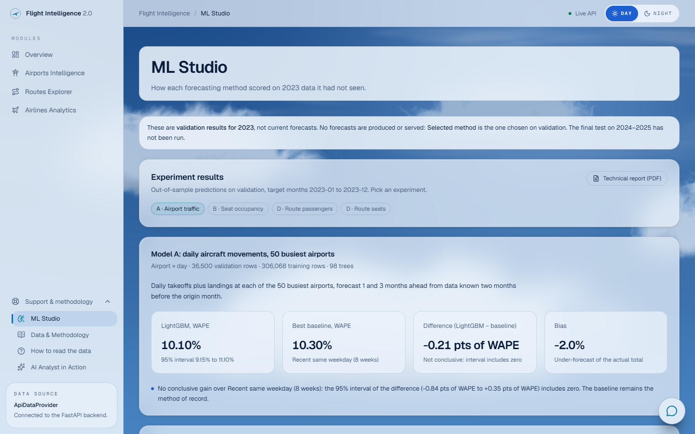
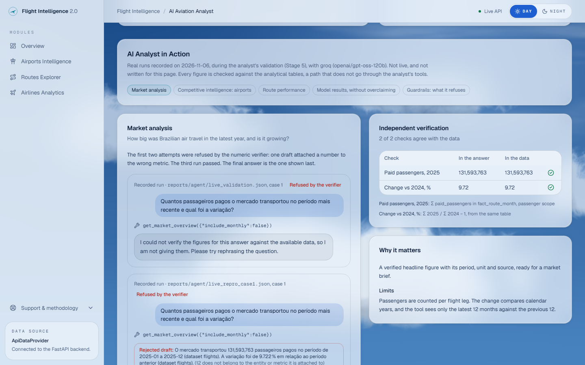
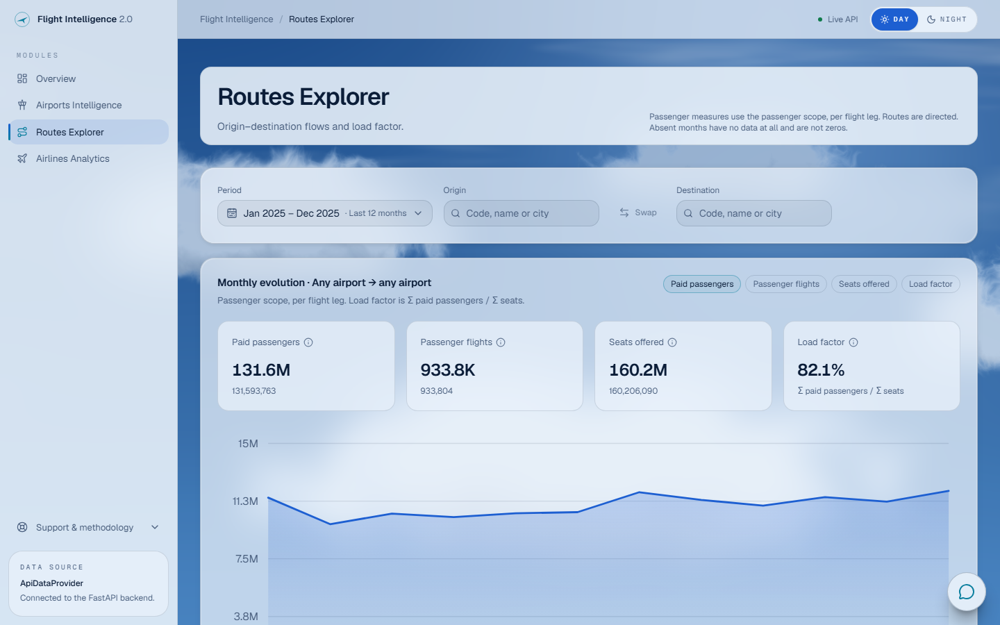
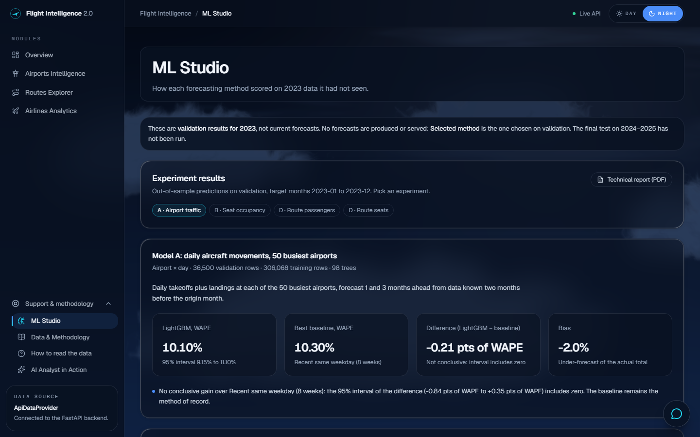
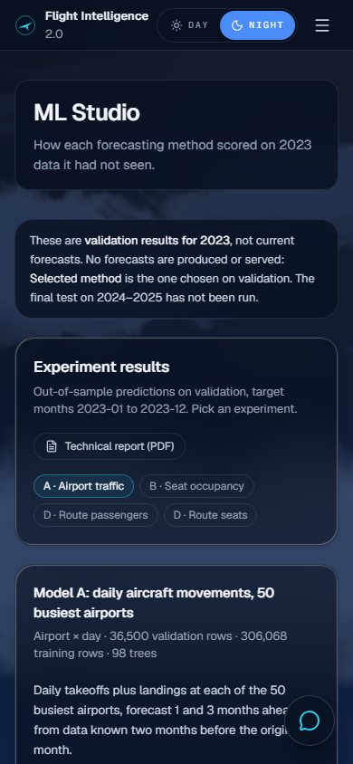

# ANAC Flight Intelligence

A reproducible data and machine-learning platform built on ANAC's air transport microdata (Brazil, 2000-01 to 2025-12): an audited ingestion pipeline, a validated analytical layer, forecasting models compared honestly against baselines, a read-only API, a Next.js dashboard and an AI analyst that answers only from these data.

**Current version: v2.** Version 1 is described under [History](#history-version-1). **Portfolio:** [caiobandeira7.github.io](https://caiobandeira7.github.io)

## The problem

ANAC publishes every Brazilian flight leg since 2000, about 20 GB of open data. Getting correct answers from it is hard: flights, passenger flights and aircraft movements are different counts, routes have a direction, load factor cannot be averaged, and four months are missing entirely. This platform does that work once, validates it, and shows every figure with its period, scope and unit.

| Overview | ML Studio | AI Analyst in Action |
|---|---|---|
|  |  |  |
|  |  |  |

*Real screenshots of the running dashboard (DAY and NIGHT themes), captured in headless Chrome. More are in [docs/portfolio/screenshots](docs/portfolio/screenshots).*

## What it does

- **Market overview:** paid passengers, flights, seats offered and load factor for any period, compared with the same months a year earlier.
- **Airports, routes and airlines:** rankings and monthly series with filters by period, airport (IATA or ICAO) and carrier. Routes are directed: CGH→SDU and SDU→CGH are separate.
- **ML Studio:** how each forecasting method scored on 2023 validation data. No forecasts are served.
- **AI Aviation Analyst:** questions in plain language, answered through a small set of fixed, read-only query tools, so it can only answer what those tools cover. Numbers in an answer are checked against the tool results. That check is heuristic: it confirms that each number appears in the results, but it does not guarantee that every association between numbers, entities, metrics and periods is correct.

## Architecture

```
ANAC CSV (~20 GB, never modified)
  → anac-ingest      Parquet dataset "flights", audited and resumable
  → anac-features    point-in-time features, chronological splits
  → anac-models      LightGBM, compared with baselines, frozen in models/v1
  → anac-analytics   star schema: dim_month, dim_airport, dim_carrier and 4 fact tables
  → anac-api         read-only FastAPI: /v2/* payloads and /v2/analytics/* queries
  → web/             Next.js dashboard and the analyst
```

| Layer | Technology |
|---|---|
| Data | Python 3.12, Polars, DuckDB |
| Models | LightGBM, baselines, block-bootstrap intervals |
| API | FastAPI, pydantic contracts mirrored in TypeScript |
| Dashboard | Next.js 16, React 19, TypeScript, Tailwind 4 |
| Analyst | Any OpenAI-compatible provider with tool calls (Groq by default); the key stays on the server |
| Quality | pytest, ruff, mypy strict, Vitest |

## Models (validation, 2023)

These are validation results on 2023, data the models did not see during training. They are not forecasts: no model serves predictions in production, and the API has no prediction endpoint. A model is adopted only if it beats its best baseline with a 95% interval excluding zero. The final test on 2024–2025 has not been run.

| Module | Target | Selected method | Validation result |
|---|---|---|---|
| A | Flight movements by airport and day | Baseline: same weekday, recent 8 weeks | WAPE 10.30%. LightGBM's 10.10% is not a conclusive gain. |
| B | Seat occupancy by route and carrier | LightGBM | Seat-weighted MAE 6.06 pts against 6.54 |
| C | Checked baggage per passenger | Not trained | Provisional target |
| D | Demand and capacity by route | LightGBM | WAPE 22.24% (passengers), 22.40% (seats) |

**Full study:** [How Predictable Is Brazilian Aviation?](research/ml-showcase/REPORT.md) ([PDF](research/ml-showcase/REPORT.pdf)): error analysis by horizon, volume, entity and month, residuals, gain importance and 37 figures. Every metric is reproduced from the saved artifacts, and an in-memory refit matches the saved predictions bit for bit (`research/ml-showcase/results/reproduction.json`). The 2024–2025 test was deliberately not run (report, Section 6.4). There is no prediction playground: the models need features computed from history, which a form cannot supply honestly.

Known limitations are in [docs/models.md](docs/models.md). They include a bias of about −12% on module D and four absent months in the data (2015-08, 2016-02, 2018-07, 2020-08).

## AI Analyst in Action

Five real runs, recorded during the analyst's validation (Groq, `openai/gpt-oss-120b`), each re-checked against the analytical tables by a path that does not use the analyst's tools ([ANALYST_DEMO.md](docs/portfolio/ANALYST_DEMO.md), and `/dashboard/analyst#in-action` in the app):

| Case | Tool | Answer | Independent check |
|---|---|---|---|
| Market size and growth | `get_market_overview` | 131,593,763 paid passengers in 2025, +9.72% | ✅ both match. Two earlier drafts were refused by the verifier |
| GRU vs CGH | `search_airports` ×2 | 287,291 and 186,664 movements | ✅ |
| CGH → SDU | `search_routes` | 1,968,523 paid passengers, load factor 77% | ✅ (76.94%) |
| Is module A a forecast? | `get_model_results` | 10.30% WAPE, validation 2023, "not current forecasts" | ✅ |
| Prompt injection, invented price | none | Refused: no price data | ✅ no price column exists |
| Passengers in 2019 | `get_data_coverage` | "Not available" | ❌ known gap: the tools cover only the latest 12 months |

The analyst has no carrier tool, so airline market share is answered by the Airlines page instead.

## What the data does not contain

There are no ticket prices or fares. Passengers are counted per flight leg. Only 320 of 1,180 airports have published coordinates. Absent months are unknown, never zero. Details are in [docs/analytics.md](docs/analytics.md).

## Business Intelligence — In Development

A Power BI report of seven pages, built on a reproducible semantic model over the analytical tables in `data/analytics/v1`. It is not available yet.

- **Source:** the same analytical tables as the API, never edited or rebuilt by the report. Whether Power BI Desktop can read these Parquet files directly has not been verified yet.
- **Reproducible:** the model, its relationships and its DAX measures are kept as text in `bi/`, so they can be reviewed and rebuilt from the repository. Data and large exports stay out of Git.
- **Rules:** load factor is a ratio of sums, and absent months are shown as missing. Measures from different fact tables are combined only where their grain, relationships and filters are compatible: a visual sliced by carrier, for example, cannot use airport movements, which have no carrier. The relationships and measures it starts from are in [docs/analytics.md](docs/analytics.md#power-bi). They have not yet been tested inside Power BI.
- **Labelling:** historical facts, derived indicators and inferences are kept apart and labelled. The report presents no forecasts, and no commercial conclusions the data cannot support.

## Run locally (Windows PowerShell)

```powershell
py -3.12 -m venv .venv
.venv\Scripts\python -m pip install -r requirements-lock.txt
.venv\Scripts\python -m pip install -e . --no-deps
.venv\Scripts\python -m pytest

.venv\Scripts\anac-api                  # http://127.0.0.1:8000/docs

cd web
npm.cmd ci
npm.cmd run dev                         # http://localhost:3000
```

Use `npm.cmd` rather than `npm` in PowerShell: if the execution policy blocks scripts, `npm` resolves to `npm.ps1` and fails, while `npm.cmd` runs either way.

### Reproduce the experiments and demos

```powershell
.venv\Scripts\python -m pip install -r research\ml-showcase\requirements.txt
.venv\Scripts\python research\ml-showcase\reproduce.py --refit   # metrics, hashes, in-memory refit
.venv\Scripts\python research\ml-showcase\analysis.py            # figures, tables, ML Studio payload
.venv\Scripts\python research\ml-showcase\build_pdf.py           # technical report PDF
.venv\Scripts\python research\analyst-demo\build_cases.py        # analyst cases, verified, no LLM call
```

To publish the API and dashboard, see [docs/DEPLOYMENT.md](docs/DEPLOYMENT.md). Nothing is deployed yet.

The API serves data built locally, which Git does not version. See [docs/ingestion.md](docs/ingestion.md), [docs/features.md](docs/features.md), [docs/models.md](docs/models.md) and [docs/analytics.md](docs/analytics.md) to rebuild it. The analyst needs `GROQ_API_KEY` in `.env` (see `.env.example`).

## Documentation

| Document | Covers |
|---|---|
| [ingestion.md](docs/ingestion.md) | Raw CSV to Parquet, audits, resuming |
| [supplements.md](docs/supplements.md) | Recovering the four absent months from official ZIPs |
| [features.md](docs/features.md) | Modules, features, leakage controls |
| [models.md](docs/models.md) | Method, validation results, API, analyst |
| [analytics.md](docs/analytics.md) | Tables, measures, coverage, Power BI, analytics API |
| [decisions.md](docs/decisions.md) | Every methodological decision and why |
| [AGENTS.md](AGENTS.md) | Rules for coding agents working on this repository |
| [DEPLOYMENT.md](docs/DEPLOYMENT.md) | Environment variables, Docker files, deployment options and validation checklist |
| [ML report](research/ml-showcase/REPORT.md) | Reproduction and error analysis of models A, B and D |
| [Case study](docs/portfolio/CASE_STUDY.md) | How the platform was built with AI agents under human control |
| [One-pager](docs/portfolio/ONE_PAGER.md) · [Demo script](docs/portfolio/DEMO_SCRIPT.md) | Portfolio summary and a 90-second video script |

## History: version 1

The first version (2018–2024 data) trained four neural and boosted models: a bidirectional LSTM for airport congestion, an FT-Transformer for seat occupancy, an MLP for a price-pressure index and a LightGBM and neural-network stack for excess baggage. It served them through a prediction endpoint, `POST /prever`, deployed on Railway, with a static `dashboard.html`. That endpoint and deployment belong to v1 and are not part of the current version.

Its scripts are kept unchanged at the repository root (`00_verificar_dados.py` to `07_monitorar_drift.py`), along with `dashboard.html`, `docker-compose.yml`, `Dockerfile.bak` and `Procfile`.

Version 2 was rebuilt from the raw data rather than extended:

- **Price pressure:** the dataset contains no prices, so v2 drops it.
- **Excess baggage:** this target measured which carriers report it, not what passengers carry. v2 replaces it with total checked baggage per passenger (module C, not trained yet). See [decisions.md](docs/decisions.md).
- **Evaluation:** every result is now chronological and compared with a baseline.

The v1 metrics were not re-validated under these rules.

## Roadmap

- Run the sealed 2024–2025 test once, without tuning
- Recover the four absent months and retrain as `models/v2`
- Power BI report and semantic model (in development)
- Route map using the airports that have coordinates

## Author

Caio Bandeira, data scientist in Brasília. [Portfolio](https://caiobandeira7.github.io) · [LinkedIn](https://www.linkedin.com/in/caio-bandeira-cv) · [GitHub](https://github.com/CaioBandeira7)

Data: ANAC open data, published under Brazil's access to information law.
