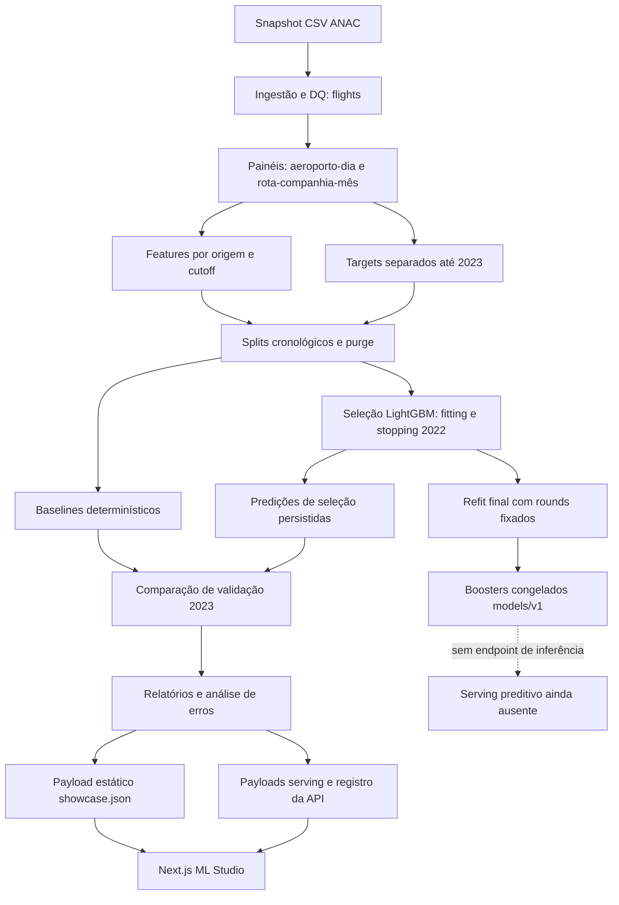

# Arquitetura de Machine Learning

Escopo desta branch: ML e sua apresentação, sobre o commit base `22a120a`.
Nenhuma alteração no Analyst, infraestrutura da v3, API publicada ou Power BI.



## Contratos e responsabilidades

| Camada | Arquivos / evidência | Responsabilidade e risco |
|---|---|---|
| Ingestão | `src/anac/ingestion`, `data/processed/flights` | DQ, referência de datas e flags; não reconstruída nesta auditoria |
| Painéis | `features/panels.py`, `data/features/v1/panels` | Contagens por endpoint e escopo passageiro; painéis contêm datas além da validação, mas a auditoria não abriu seus targets de teste |
| Features | `daily.py`, `monthly.py`, `contracts.py` | Histórico limitado ao cutoff; calendário futuro permitido; schema/stamp/chave validados |
| Divisão | `splits.py`, `configs/features.toml` | Exclusão de meses desconhecidos no caminho supervisionado e guards de teste; purge por distância |
| Baselines | `evaluation/baselines.py` | Regras de comparação com fallback explícito; nada de target como entrada |
| Treino | `models/train.py`, `configs/models.toml` | Escalas/pesos, seleção, refit separado, FrozenModelExists |
| Avaliação | `evaluation/metrics.py`, `reports/models` | Fórmulas e bootstrap; reports v1 imutáveis nesta revisão |
| Auditoria | `scripts/audit_ml.py`, `results/audit.json` | Fonte parametrizada e somente leitura, hashes antes/depois, oráculo NumPy e replay de compare |
| Apresentação | `analysis.py`, `web/public/ml/showcase.json` | Agregações e amostra limitada de pares; não chamar de “sem dados de linha” |
| Relatório | `REPORT.md/html/pdf`, `web/public/ml/report.pdf` | Documento histórico com erratas e PDF regenerado, preservando as figuras anteriores |
| Interface | `ml-showcase.tsx`, `ml-charts.tsx` | Leitura/seleção de resultados, explicações e tooltips; nenhum treino/inferência |

## Dados e artefatos

Arquivos de modelo/predições/datasets são ignorados pelo Git; a auditoria aponta para uma
raiz de artefatos existente, sem copiar `.env` nem reutilizar instalação editável de outro worktree.
São carregados somente features/targets supervisionados já limitados a 2023 e predições salvas.
Os `.txt` finais são autenticados por hash; não usados para obter novos scores de validação.
O hash dos painéis é uma leitura binária de integridade, não avaliação de targets 2024–2025.

A rastreabilidade v1 tem limites: digest de dataset por nomes/tamanhos, vocabulários sem hash
no manifest e commit de treino com árvore suja. Um protocolo futuro deve registrar conteúdo,
versões, código/config completos, vocabulário, ranges efetivos e identidade do modelo selecionado.

## Endpoints reais

| Caminho | Origem e propósito | O que não faz |
|---|---|---|
| `GET /v2/models` | `serving/export.py::build_models/_validation_cards`, relatórios estáticos A/B/D + baselines | Não carrega booster nem executa predict |
| `GET /v2/modules` | Descrição dos módulos/contratos | Não demonstra que C foi treinado |
| `GET /v2/datasets` | Metadados de datasets e lacunas | Não comprova vintage histórico |
| `GET /ml/showcase.json` | Arquivo estático Next.js | Não é endpoint FastAPI nem previsão atual |
| `GET /ml/report.pdf` | PDF histórico versionado | Não é relatório recalculado a cada acesso |
| Analyst/tool models | Consulta o mesmo catálogo de resultados | Texto generativo não é previsão LightGBM; nenhuma chamada LLM foi executada nesta auditoria |

A API valida envelopes via Pydantic; ausência de payload resulta em 503, não dados inventados.
Nenhuma rota `/predict` consta do conjunto v2 auditado. Scripts `06_api.py` e outros legados
não são o serviço ativo. Não se criou endpoint novo nem mudou contrato compartilhado com Claude.

## Correções sem contaminar a versão congelada

O loader/baseline corrigidos rejeitam meses globalmente ausentes antes de zerar uma rota inativa.
Targets e features selados são rejeitados por índice mensal ou data diária. AP agrupa empates.
O KPI B passa a mostrar viés ponderado em pp, preservando o campo relativo antigo para
rastreabilidade. O payload/generator guardam o novo campo explicitamente.
Qualquer treino real corrigido requer saída nova (`models/v2` ou outro nome), nunca overwrite v1.
Não houve migração automática, rebuild dos Parquets, deploy ou promoção do modelo corrigido.
Em clones novos, o typecheck do Next.js agora executa `next typegen` antes de `tsc`,
pois `LayoutProps` depende dos tipos gerados de rotas nesta versão.

## Reprodução da auditoria

```powershell
py -3.12 -m venv .venv
.venv\Scripts\python -m pip install -r requirements-lock.txt
.venv\Scripts\python -m pip install -e . --no-deps
.venv\Scripts\python scripts/audit_ml.py --artifact-root D:\anac-flight-intelligence-api-main
.venv\Scripts\python scripts/build_ml_audit_docs.py
.venv\Scripts\python -m pytest
```

`--artifact-root` pode ser outra pasta que contenha os artefatos históricos esperados;
não aponta implicitamente para o worktree principal. O script verifica hashes antes/depois.
A evidência não exige rebuild/ingestão nem novos modelos. `--refit` do estudo antigo não foi
executado e não deve ser usado para alegar identidade após a correção do loader D.
