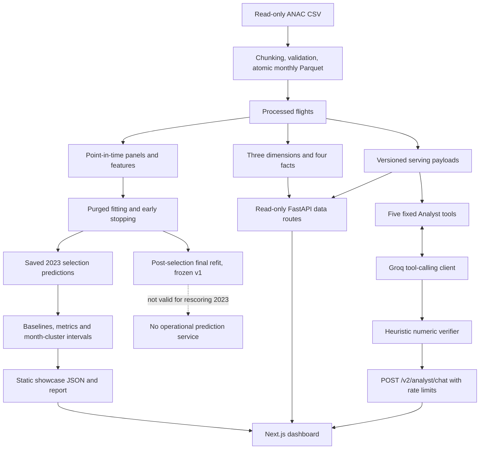

# Data, ML and application architecture

## Modules and boundaries

- `src/anac/ingestion` and `validation`: bounded parsing, flags, rejects, line accounting, independent DuckDB verification and resumable publication. The 20 GB source is not loaded whole into memory.
- `src/anac/features`: scope rules, panels, temporal stamps, categorical/numeric contracts and purged splits. The two-month publication lag is a documented assumption, not a complete historical availability reconstruction.
- `src/anac/models` and `evaluation`: fitting/early stopping, frozen manifests, saved selection predictions, baselines and metrics. Guards reject sealed target dates/months, including mislabeled features. Missing target months are excluded before known-inactivity zero fill.
- `src/anac/analytics`: analytical tables and read-only DuckDB queries. Tables have distinct grains; ratios are recomputed from sums.
- `src/anac/serving`: result cards and fixed tool payloads. API `/v2/models`, `/v2/modules`, `/v2/datasets` describe data/results, not inference.
- `src/anac/api` and `agent`: validated contracts, environment-configured CORS, fixed tools, Groq-compatible client and heuristic numeric verification. Chat quotas are per-process in-memory state.
- `web/components/dashboard/ml-showcase.tsx` and `ml-charts.tsx`: render `/ml/showcase.json`; no model inference occurs in the browser. The report is `/ml/report.pdf`.

## Reproducibility

The repository versions source, contracts, configuration, reports and aggregate presentation data. `data/`, models, Parquet, `.env`, dependencies and builds are ignored. Numerical reproduction requires separate input artifacts; a code-only clone cannot reconstruct omitted data or boosters by itself. The audit hashes 29 inputs and reconciles saved 2023 predictions without refitting. Its output is confined to `research/ml-showcase/results`.

Historical reproduction records predate the D fix. Full `analysis.py` regeneration includes previously exposed historical analytical series; do not describe it as a newly blind holdout evaluation. Final v1 boosters cannot score 2023 as unseen data. The 2024–2025 holdout was partially exposed but unscored. C is not trained.

See [deployment configuration](../../DEPLOYMENT.md), [analytics contracts](../../analytics.md) and [model catalog](MODEL_CATALOG.md). Portfolio generation uses tracked evidence and screenshots only, without rebuilding analytics or training models.
